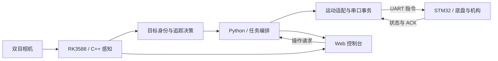

# 基于视觉识别的智能犊牛投喂系统

**RK3588 边缘视觉与移动投喂控制端**

面向犊牛岛及棚舍中的移动投喂场景，本项目将投喂桶识别、双目测距、目标追踪和车辆／机构执行连接成可观察的自动任务流程，支持车辆靠近目标、调整投喂位置，并将画面、执行步骤与设备状态显示在网页端。

本仓库维护边缘端软件 `bucket_robot`：C++ 负责相机采集、RKNN 检测与双目计算，Python 负责目标身份、追踪决策、任务编排、串口事务及本地 Web 控制台。

## 项目定位

项目申报方案采用“云端管理—边缘感知—终端执行”的分工，将场区任务转化为现场动作，并回传执行状态。

| 组成 | 职责 | 工程范围 |
| --- | --- | --- |
| 云端管理 | 场区地图、犊牛岛点位、路线方案、投喂任务与设备管理 | 配套 Web／后端工程 |
| RK3588 边缘端 | 视觉识别、测距、同桶追踪、靠桶与机构动作编排、现场监控 | **本仓库** |
| STM32 执行端 | 底盘与执行机构驱动、状态回传、底层互锁 | 配套固件工程；本仓库提供上位机协议与控制适配 |

整体方案还包括犊牛识别、GPS／场区导航、云端调度和定量供液。本仓库当前的自动任务以白色投喂桶为识别对象，覆盖现场感知、车辆对位与机构执行。

## 核心能力

| 能力 | 当前实现 |
| --- | --- |
| 现场感知 | 双目相机采集与校正、RKNN 投喂桶检测、桶身采样区测距；靠近阶段结合双目与模型辅助测距 |
| 同桶持续追踪 | 初始目标获取、A/B 居中追踪、近距离裁切目标保持、遮挡后原目标验证与恢复 |
| 自动靠桶 | 追踪与距离门控协同，渐进加减速；支持左视边界交接、连续侧移靠近及有限航向纠偏 |
| 机构执行 | A 转向、B 升降、C 伸缩；复用有效零点，按 C→B→A 顺序归位，动作交接等待禁用确认 |
| Web 控制台 | 实时画面、实际接收帧率、目标纵深、X/Y 偏差、启动自检、温度监控及运动操作 |
| 执行过程可见 | 在“运行日志”内显示当前任务步骤、完成／等待／暂停／故障状态，并保留原始运行事件 |
| 故障降级 | 组件分别检查与恢复；缺少控制器时仍可提供可用的视频和检测，停止未确认时锁定运动 |
| 工程交付 | Python wheel、CMake 原生程序、显式模型与标定、逐文件 SHA256 发布清单及版本回退 |

静止追踪与行进任务共用 `TrackingController`、`FollowPolicy` 和身份策略，命令统一经过 `motion` 与 `transport`。任务增加阶段和转移条件，成熟追踪与串口能力保持单一实现。

## 系统架构



物理执行只有一条串口所有权与确认链路；控制台读取任务实际使用的目标和阶段。检测与辅助测距使用各自匹配的 RKNN 运行库路径，部署时分别维护。

现场运行需要 RK3588、双目相机、STM32 控制器，以及底盘和 A/B/C 执行机构。当前检测模型绑定为 `B1_C0_REG_FP16`，标定采用 30 mm 打印棋盘方案；具体文件与摘要见[模型来源](deploy/vision_cpp/model_source.json)和[标定来源](deploy/vision_cpp/calibration_source.json)。Python 包、原生程序、模型和配套运行库需要按发布手册一起组装；旧 `vision_v2` 模型保留用于历史兼容。

## 当前版本与任务流程

当前固定版本为 **v0.3.9**，标准板端目录为 `/home/elf/bucket/releases/0.3.9`，默认启动入口为 `/home/elf/bucket/start_full_mission.sh`。

完整任务按以下流程执行；具体阶段可因目标可见性、距离及左视姿态进行交接：

1. 检查设备与回传，复用有效零点；需要归位时依次收回 C、B 回顶、A 回正。
2. 自动获取投喂桶，执行桶框中心 A/B 追踪。
3. 前进靠近并测距减速；先到左视边界时转入左侧测距与连续靠近。
4. 完成前移对齐与停车确认，执行额外定时左移。
5. 暂停追踪，B 连续回顶，确认后 C 伸出，最后确认输出禁用。

| 当前默认参数 | 设置与含义 |
| --- | --- |
| 瞄准方式 | 桶框中心，B 按高度误差跟随；调整 B 前先确认底盘停车 |
| 前进巡航目标 | 80% 协议目标；约 40 cm 开始减速、约 20 cm 停车确认 |
| 额外左移 | 40% 协议目标、固定 2 秒；计时动作，不表示经过标定的固定厘米位移 |
| 末端机构 | B 回到 0，C 伸至 150 mm；A 回正参考为 73 指令度 |
| 串口 | 115200、8N1；沿用 B3/B4 下行与 B5/B6 回传协议 |

速度百分比是控制器目标，A 指令度也不是独立角度编码器测量。当前参数分别由 [mission profiles](src/bucket_robot/resources/mission_profiles.json)、[定时左移动作](src/bucket_robot/missions/timed_translate.py)和[机构参考配置](src/bucket_robot/resources/arm_reference.json)维护。

**验证依据：** [v0.3.8 发布记录](docs/releases/v0.3.8.json)包含一次完整、无人工干预的实车流程及最终禁用确认。v0.3.9 在该版本上增加连续归位，已有软件检查通过，本版未新增完整实车复测；具体记录见 [v0.3.9 发布记录](docs/releases/v0.3.9.json)和[连续归位说明](docs/continuous-home-20261127.md)。

## 快速使用

### 开发机环境

Python 要求为 **3.10 及以上**。下面的依赖安装用于开发机；RK3588 运行环境沿用已经核验的 Python、OpenCV、NumPy 和系统 RKNN 库。

```sh
python3.10 -m venv .venv
.venv/bin/python -m pip install -e '.[desktop,dev]'
.venv/bin/python -m bucket_robot --help
```

仓库提供 `bucket-track`、`bucket-mission`、`bucket-forward`、`bucket-telemetry` 四个安装式命令；日常现场运行优先使用固定发布包及其启动脚本。

### 板端只读检查与预览

在 RK3588 上检查默认入口与发布文件，不打开控制串口、不启动任务：

```sh
/home/elf/bucket/start_full_mission.sh --check
```

启动仅预览模式，允许相机与检测工作，机构运动保持禁用：

```sh
/home/elf/bucket/releases/0.3.9/run_track.sh --observe-only
```

RK3588 本机控制台地址为 `http://127.0.0.1:8788/`。开发机配置好 `rk3588` SSH 别名后，可建立转发：

```sh
ssh -N -L 127.0.0.1:18788:127.0.0.1:8788 rk3588
```

随后在开发机打开 `http://127.0.0.1:18788/`。

### 执行完整任务

以下入口会控制底盘和 A/B/C 机构。按[完整流程运行说明](docs/run-full-mission-20261126.md)放置车辆并核对现场条件后运行：

```sh
ssh -t rk3588 /home/elf/bucket/start_full_mission.sh
```

入口为每轮任务创建独立日志目录，处理已结束的旧控制台，并核对控制器状态。终端 `Ctrl+C` 或网页“停止机构”可请求停车，完成状态以控制器禁用回传为准。零点准备、仅机构准备、停止确认及恢复方式见运行说明。

## 控制台读数

- **画面帧率**：浏览器实际收到并解码的不同画面帧，与板端检测或追踪处理帧率分别统计。
- **目标纵深 Z**：桶身采样区域的相机前向距离，单位 m；辅助靠近使用的光学中点到桶表面距离保留独立语义。
- **X/Y 偏差**：当前任务目标相对画面中心的像素偏差，向右／向下为正。
- **自检与执行步骤**：由真实组件状态、任务阶段与动作确认生成；缺失或过期读数显示 `—`。

温度监控使用板端实际提供的热区。诊断详情和执行步骤均支持区域内滚动，模型或控制器不可用时仍展示其余可用能力。数据来源及展示规则见[控制台说明](docs/resilience/console_ui_20261126.md)。

## 开发、验证与发布

在开发机运行软件检查：

```sh
.venv/bin/python -m unittest discover -s tests -t . -v
.venv/bin/ruff check src tools/field tools/release tools/calibration tools/build
.venv/bin/ruff format --check src tests tools/field tools/release tools/calibration tools/build
.venv/bin/python -m build --wheel
```

测试覆盖合成视觉场景、PTY 模拟串口、180 条原 A/B 决策对照、目标恢复、停止确认、组件故障及网页展示；Node.js 用于前端展示契约检查。正式控制台是随 Python 包发布的 HTML/JavaScript，无需独立前端服务。

原生程序使用 CMake 构建，可按[本地 ARM64 构建说明](tools/build/README.md)在无设备容器中验证编译和回放。随后按[发布手册](docs/release.md)组装 wheel、原生程序、模型、标定与运行库，校验完整清单，再选择现场入口。软件回归、包校验与实车验收分别记录。

## 仓库结构

```text
src/bucket_robot/
  domain/        只读设备接口、状态表示与清理结果
  perception/    读帧、目标身份、恢复与辅助测距
  tracking/      共用追踪控制器、策略与对准判断
  motion/        机构／底盘适配、到位与禁用确认
  transport/     原协议编解码、单次写帧与遥测
  missions/      任务配置、阶段、恢复门控与后处理
  runtime/       启动准备、HTTP 控制台、健康与进程监督
  resources/     机构、任务 profile 及生产入口配置
deploy/vision_cpp/   C++ 感知源码、CMake 与模型／标定来源说明
tools/               现场、标定、构建与发布工具
tests/               统一回归与网页展示契约
docs/                架构、协议、运行及版本验收记录
experiments/         尚未接入正式流程的候选实现
```

旧 `deploy/` Python 入口保留兼容转发。本地研究资料与产物分别放在 `research/`、`outputs/` 等目录，不作为正式运行依赖，也不随源码提交。完整资源导航见 [WORKSPACE.md](WORKSPACE.md)。

## 文档导航

| 文档 | 适用内容 |
| --- | --- |
| [完整流程运行方式](docs/run-full-mission-20261126.md) | 现场入口、预览、准备、停止及任务日志 |
| [架构与能力所有权](docs/architecture.md) | 分层依赖、共用控制器及新增任务的方法 |
| [启动与任务状态收敛](docs/architecture-consolidation-20261126.md) | 统一账本、目标来源、阶段与清理契约 |
| [故障隔离与恢复](docs/resilience/README.md) | 组件降级、能力门控与运动锁存 |
| [构建与发布](docs/release.md) | wheel、CMake、完整发布包与校验 |
| [串口接口](docs/interfaces/serial-phase1-20261118.md) | 下行命令、遥测字段与确认语义 |
| [双目标定](docs/stereo-recalibration-20261122.md) | 已采用的打印棋盘标定与验证范围 |
| [航向纠偏](docs/heading-correction-20261127.md) | 有限纠偏策略、软件检查与实车记录 |
| [连续归位](docs/continuous-home-20261127.md) | C/B/A 启动归位与末尾 B 一次回顶 |

## 许可证

仓库代码采用 [MIT License](LICENSE)。第三方追踪组件说明见 [THIRD_PARTY.md](deploy/vision_cpp/tracking/THIRD_PARTY.md)。
