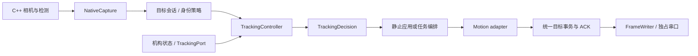

# RK3588 软件架构与维护入口

当前工程采用模块化分层应用。Python是安装式src包，C++使用CMake目标；相机/NPU计算进程与Python控制进程的边界保持不变。业务任务组合现有能力，核心源码只维护一份。

## 代码地图

```text
src/bucket_robot/
  domain/       位置表示、设备接口Protocol；无硬件导入
  resources/    随wheel发布的默认配置，支持显式站点配置
  perception/   帧读取、目标获取/身份/恢复、光流、测距
  tracking/     FollowPolicy、AlignmentGate、TrackingController
  transport/    B5/B6解析、B3/B4单次写入
  motion/       机构和底盘适配、命令编号/ACK/禁用确认
  missions/     任务门控、阶段切换、机构与底盘互锁编排
  runtime/      启动准备、HTTP界面、日志、进程管理、发布校验
tests/          合成图像、PTY模拟串口、控制轨迹与架构契约
tools/          人工现场工具、标定、固件诊断、发布构建
experiments/    尚未接入正式运行的候选算法
deploy/vision_cpp/  原生C++源码、CMake与构建兼容入口
deploy/         旧Python/脚本入口的兼容转发
outputs/        本地证据与生成结果，不作为源码依赖
```

依赖方向由`tests/test_architecture.py`检查。domain不依赖设备；transport和motion不依赖任务；perception不依赖控制；tracking消费感知与设备只读接口；missions消费这些能力。发布目录结构校验是纯文件操作，允许任务管理器使用`runtime.release`。生产包不能导入tools、tests或日期目录。

## 控制所有权



- `TrackingController.step()`统一身份变化、帧新鲜度、居中停调、行程限制和A/B目标。保留`FollowPolicy`的原数学控制与参数；静止应用和`VerticalSupervisor`调用同一个组件。
- 行进阶段的横向控制使用同一组件的`horizontal_goal()`；B需要调整时先停车并确认，再使用共同的A/B调度。任务模块不能调用`next_a/next_b/choose_axis`或直接发送串口帧。
- `ContinuousArmPort._send_target()`是持续目标命令的唯一事务提交点；机构与底盘适配器负责各自的允许运动条件，编号、pending、ACK及禁用流程共用基础实现。
- `FrameWriter`只写入已打开的独占FD，不加载旧工程、不启动发送线程、不盲重发。原10字节命令格式保持不变。
- `new_target_session()`显式选择身份策略。普通观察可以获取新身份；行进任务只能恢复原目标。阶段交接复用同一目标会话，并要求前一观察线程已经停止。
- `NativeCapture`统一帧号、时戳与图像形状检查，左图与双目输入仅由端点/尺寸/年龄预算区分。

这些边界保留两项有意差异：静止和行进的目标身份策略不同；实时前向Z和停车时光学中点到桶身表面距离不同。检测与Fast-ACV运行库仍在独立进程/库路径中隔离，不能替换成同一个全局RKNN库。

## 增加一个任务

1. 从已有FrameSource与目标会话读取观察，不另开一条检测/追踪链。
2. 注入已有TrackingController，消费决策，不拷贝A/B控制公式。
3. 新增任务阶段与转移条件；运动经motion适配器执行。
4. 为新增业务规则添加对照/故障用例；现有核心回归直接复用。
5. 构建新的wheel与完整发布包，核验清单，再进入现场验收。

正常新增任务不需要改动transport、tracking内部算法。确实需要新增底层能力时，先扩展相应正式接口，再让各任务共同使用。

## 配置、日志与旧入口

默认机构配置在`src/bucket_robot/resources/arm_reference.json`；`deploy/serial_rx/arm_reference.json`是兼容符号链接。现场部署使用发布包中的同一份配置。普通进程重启和串口重连继续沿用原零点；启动准备仍由原持久化账本和组合重启证据管理。

旧模块是`sys.modules`别名，保留类身份与旧导入兼容；它们不包含控制实现。直接执行旧脚本需要先安装包。现场工具移至`tools/field`、`tools/calibration`和`tools/chassis_debug`，不进入正式运行wheel。

任务日志、录像和状态账本写到发布目录外。启动记录发布ID和完整子进程参数；发布清单覆盖全部入口、源码、配置、模型、标定和动态库。`verify`会拒绝缺失、变化和未声明文件。

## 验证与适用范围

迁移前源码与摘要保存于`outputs/architecture_refactor_20261125/`。`tests/fixtures/ab_control_trace.json`由该迁移前源码产生，记录180个A/B决策，覆盖追踪、居中、反向、身份切换与连续机构反馈；两个上下文均须逐项一致。它证明软件决策保持，不替代真实车辆运动验收。

测试使用PTY模拟MCU，不访问真实串口。相机/NPU实机时延和完整自动靠桶的物理验收独立进行。冻结v1作为只读回退保留，不由新部署工具覆盖。

采用的标准入口：[PyPA src布局](https://packaging.python.org/en/latest/discussions/src-layout-vs-flat-layout/)、[pyproject与console scripts](https://packaging.python.org/en/latest/specifications/pyproject-toml/)、[Python Protocol](https://typing.python.org/en/latest/reference/protocols.html)、[CMake安装目标](https://cmake.org/cmake/help/latest/guide/tutorial/Installation%20Commands%20and%20Concepts.html)。

## 故障隔离与降级运行

`runtime.application`统一拥有`track`和`mission`的界面、健康状态及工作进程生命周期。HTTP先启动；相机、模型、配置和串口后台初始化。组件故障只关闭依赖它的能力。模型进程崩溃或卡死由进程边界隔离；界面不依赖推理进程存活。

`HealthRegistry`是组件与能力状态的共同来源，执行循环和API在服务端门控运动。设备恢复不会自动解除运动故障锁存；停止未确认不能通过恢复按钮解除。探测只读回传，不通过试运动证明设备存在。原有追踪控制和零点账本继续复用。

详细接口、故障矩阵、阈值和维护入口见[故障隔离说明](resilience/README.md)。
