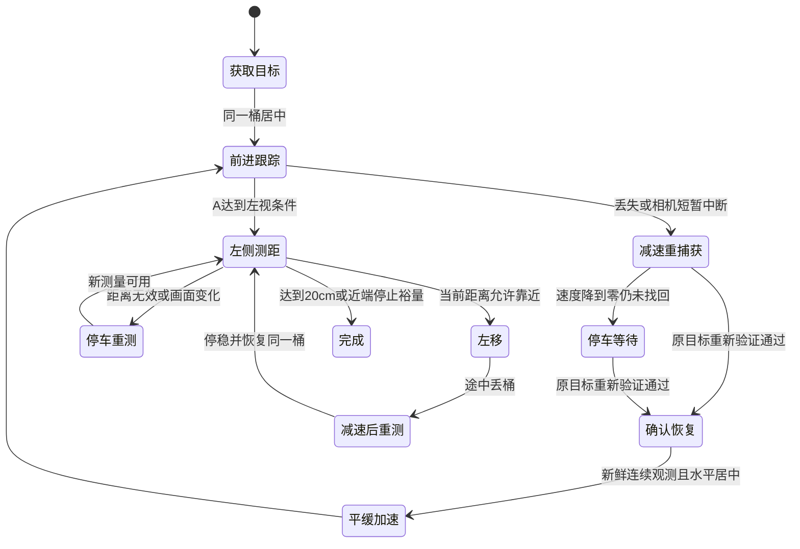

# 跟踪丢失后的任务恢复

后续状态：用户随后授权实车测试，补丁已部署，并完成前进对齐及分段左移；详见 [实车靠桶验收记录](recovery-acceptance-20261125.md)。本文以下保留部署前的设计与离线验证记录。

本阶段要回答的问题：目标短暂不可见时，能否给已有重捕获算法留下恢复时间，并让车辆减速、等待、恢复，而不结束整项任务。

结论：已在本地实现并通过离线图像及模拟串口验证。用户要求暂停实车后，核对到6帧A85/B0/C0、计数70、输出禁用；随后停止本轮原生视觉进程。以下新逻辑没有下发，也没有启动实车。

## 为什么原来会提前结束

原试验程序在 `Observer` 看到一次空目标时就抛异常并退出观察线程，外层随即停车并结束进程。已有 `TargetTracker.recover()` 的多帧外观确认因此没有机会继续运行。新增任务层将“当前没有可靠观测”与“任务必须结束”分开，保留最后有效图像、桶身份和行程进度。

## 当前行为

- 前进仍以8%为巡航目标。视觉失效时按每秒10个百分点降低速度指令，8%至0最多约0.8秒；恢复同一桶并得到至少3帧、跨度0.25秒的居中证据后，按每秒8个百分点恢复速度。初次居中仍需0.7秒确认。上述是指令变化率，尚未标定为实际车速或减速度。
- 丢失时冻结无视觉依据的A调整，保持B/C为0；串口控制循环独立于视觉重捕获继续运行。减速不依赖新图像到达，图像中断不会阻断减速命令。
- 重捕获复用原 `TargetTracker.recover()`：候选须与旧位置相关、外观匹配并经多帧确认。歧义、不同外观、重复旧帧不允许重新行驶。当前任务ID保持不变，不选择全图最高分目标替代原桶。
- 恢复时清除旧跟踪速度预测，再使用新观测调整A。A132仍只是已校准的左视参考，不能直接设置A132来替代前进对齐。
- 左移沿用“停车测距→短脉冲→停车重测”。无效测距会留在等待/重测状态。若脉冲途中丢桶，则逐级减速，即使中途恢复，也先停稳并重新测距，再决定下一次侧移。一次正常脉冲仍为0.6秒；丢失后的指令减速最多增加0.8秒，累计运动预算继续计算。
- 串口失联、硬件故障、航向越限、控制循环停顿等触发禁用，任务保留为 `fault_paused`，记录是否收到了停车确认，不自动清故障或重新使能。`SIGHUP`进入停车暂停；明确STOP/SIGINT/SIGTERM结束运行。行程预算耗尽进入停车暂停，不靠重试刷新预算。
- `task_status.json`记录当前阶段和等待原因；`vision.jsonl`记录无目标及重捕获过程；`serial.jsonl`/`events.jsonl`保留实际发送的速度目标和禁用确认。异常暂停不等于继续盲行。

## 验证证据

本机Python虚拟环境运行69项串口相关检查，67项通过，2项Linux专用接收检查因当前为macOS跳过。日志：`outputs/tracking_recovery_20261125/tests.log`。

1. 图像恢复：遮挡、相机异常、完整/截断桶、阶段交接时桶在图像中小幅移动；恢复同一目标，身份不变。
2. 反例：错误外观、多个相关候选、重复旧帧、长期无目标、控制循环停顿；没有误恢复行驶。
3. 实际上位机主循环接PTY：丢桶→速度逐级降低→确认禁用→重新确认→逐级恢复8%；任务没有重启。A/B/C边界和原协议保持。
4. 侧移主循环接PTY、模型桩：首次测距无效后重试；途中丢桶后逐级减速；停稳重测到20cm后结束。模型测距期间确认没有输出使能。
5. 注入航向/UART错误：正常发送禁用并等待回传，任务进入仍存活的暂停状态；不会因运动守卫再次抛错而打断停车确认。

模拟过程中的速度、距离和MCU状态用于检查控制语义，不是新增实车测量。当前尚未证明实车减速曲线、重捕获耗时或20cm完整验收。

## 交付与后续

补丁范围为 `recovery_control.py`、`target_recovery.py`、`recovering_approach.py`及现有前进/侧移入口、目标跟踪辅助、串口路径选择。正式组合入口增加 `--recover-loss`；低层短动作探针仍可保留原来的严格退出行为。配置、文件哈希及待部署包见 `outputs/tracking_recovery_20261125/manifest.json` 和 `prepared_patch.zip`。当前无固件、全局启动服务或现场部署变更。

建立的认识：一次目标失效应是任务状态变化，原来的直接退出确实截断了既有恢复能力。

关键证据：图像重捕获和两段真实上位机控制循环均通过模拟串口验证，覆盖减速、停车、恢复、错误目标及硬故障暂停。

下一项最有价值的实车工作：用户重新授权测试后，一次运行中短暂遮挡同一桶，观察实际减速与恢复，再检查靠桶阶段的相同恢复行为；无需重做前进和左右轮向测试。

独立待办：Python状态机无法在进程被强制杀死、原生库崩溃或主控掉电后继续发停车命令；这类情况需要独立看门狗/下位机通信超时机制。本次未修改固件，也未把这类兜底宣称为已实现。
